# Inkwell

Inkwell is a small Linux system of its own for the jailbroken Kindle Paperwhite 3. Amazon's bootloader and kernel still start the device, and everything after that is replaced: the home screen, the apps, Wi-Fi, USB networking and SSH all come from an Alpine Linux userspace built for the e-ink panel.

It has a chatbot called Quill that runs a language model on the Kindle itself with no internet, and in the terminal Quill writes and runs code. It reads EPUB and PDF books, keeps arXiv papers for reading offline, and plays Doom, chess and the first version of Minecraft. It also has a reading web browser, notes, a sketchpad and a falling-block game called TriKing. You install it by copying one folder to the Kindle and tapping one item in the library, and one more tap brings the normal Kindle back.

<p align="center">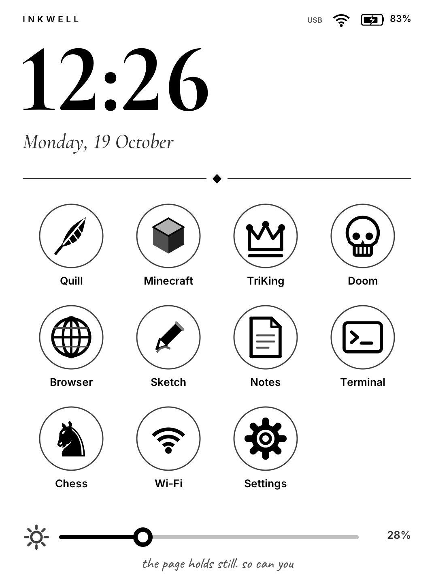</p>

These clips are from a real Kindle Paperwhite 3. Some are sped up, and each caption says by how much.

| Quill | Doom | Minecraft |
| :---: | :---: | :---: |
| 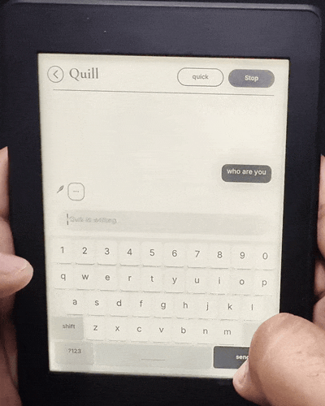 | 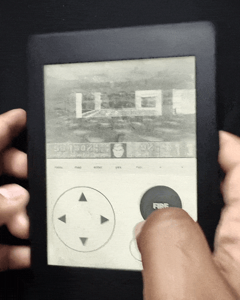 | 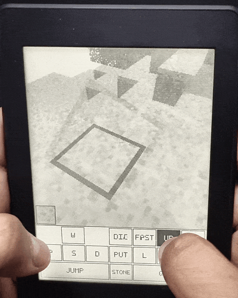 |
| An AI chatbot that runs offline (4x speed) | The shareware episode with touch controls (1.25x) | rd-132211, dithered for e-ink (1.15x) |

| Waking up | Browser | Sketch |
| :---: | :---: | :---: |
| 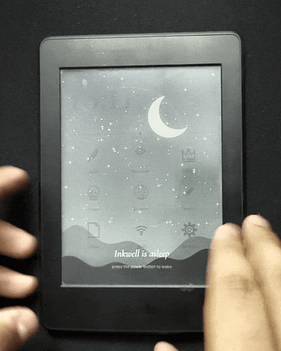 | 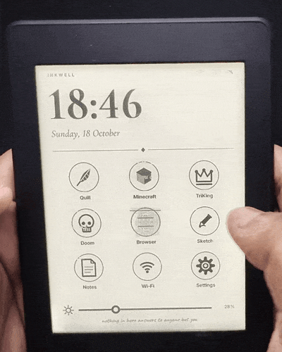 | 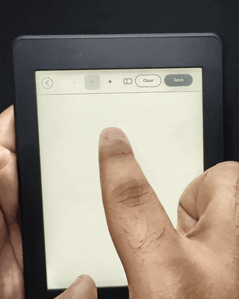 |
| From the sleep screen to home (real time) | GitHub, in pages you turn (1.5x) | Drawing with a finger (3x) |

## What is on it

- **Quill** is a chatbot that runs SmolLM2 through llama.cpp on the Kindle's own processor. It writes its answer word by word at about 1.7 words per second with the quick model, and a slower smart model can be added. Nothing leaves the device.
- **Books** reads EPUB, PDF, MOBI, FB2 and text files from the `documents` folder through MuPDF. Books reflow to eight font sizes, and PDFs are shown with their margins trimmed, or in a Columns mode that cuts a two-column paper into strips the width of the screen. You tap the right of the page to go on and the left to go back. The top opens a page slider, the table of contents and bookmarks, and every book reopens on the page where you left it.
- **arXiv** fetches a paper by its number, such as `1706.03762`, and shows its title, authors and abstract. **Save offline** downloads the PDF to the `arxiv` folder and opens it in Books, and saved papers stay listed for reading without Wi-Fi.
- **Doom** is the original shareware episode. The game is drawn into the top of the screen, dithered to black and white so each frame can use the fastest refresh, and played with an on-screen d-pad, Fire and Use buttons.
- **Minecraft** is rd-132211, the first version of Minecraft from 2009, through [rdgeneric](https://github.com/pragyaangaur/Can-It-Run-Minecraft). You can walk, dig and place blocks.
- **TriKing** is a falling-block game where every piece has three cells. You tap the board to rotate, drag to move and flick down to drop.
- **Browser** fetches a page, keeps the headings, paragraphs and links, and lays them out as pages you turn. It searches with Bing.
- **Chess** plays against Inkwell's own engine, a small alpha-beta search written for this processor. Easy answers at once, Medium thinks for up to two seconds and Hard for up to six. You can play either colour and take moves back, and the game is saved to the `chess` folder, so you can carry on later.
- **Terminal** runs a shell on the Kindle with an extra row of keys for Esc, Tab, Ctrl and the arrows. It handles full-screen programs such as `vi` and `top`, and `ssh` connects to the computer on the other end of the USB cable. Hiding the keyboard shows the whole screen. Python 3 is installed.
- **Quill in the terminal.** Typing `quill` there starts a coding assistant. You ask for a program in plain words, `/run` runs the code from the last answer with Python or `sh`, `/fix` sends its error back for a corrected version, `/save` writes it to a file and `/read` shows Quill one of your files. It uses Qwen2.5 Coder 0.5B when that model is installed, which writes about half a word per second, so a short program takes a few minutes.
- **Notes** saves plain text files to the `notes` folder on the Kindle's drive, so you can read them on a computer.
- **Sketch** is a drawing pad that saves pictures to the `sketches` folder.
- **Wi-Fi** scans for networks and joins them with the on-screen keyboard.
- **Settings** restarts or powers off the Kindle, opens the normal Kindle UI once, draws the battery over the last day, and shows memory and storage.

The home screen also has a clock, the date, the battery and a frontlight slider. To move an app, drag it onto another place. The Kindle sleeps after 15 minutes without a touch in any app, or when you press the power button on the home screen or in Books, and it shows a night sky while it sleeps. When it wakes, the app is just as you left it. With Wi-Fi on, the clock sets itself from the network.

| Books | arXiv | PDF in Columns mode |
| :---: | :---: | :---: |
| 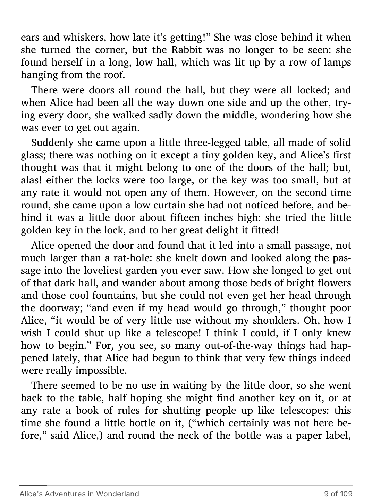 | 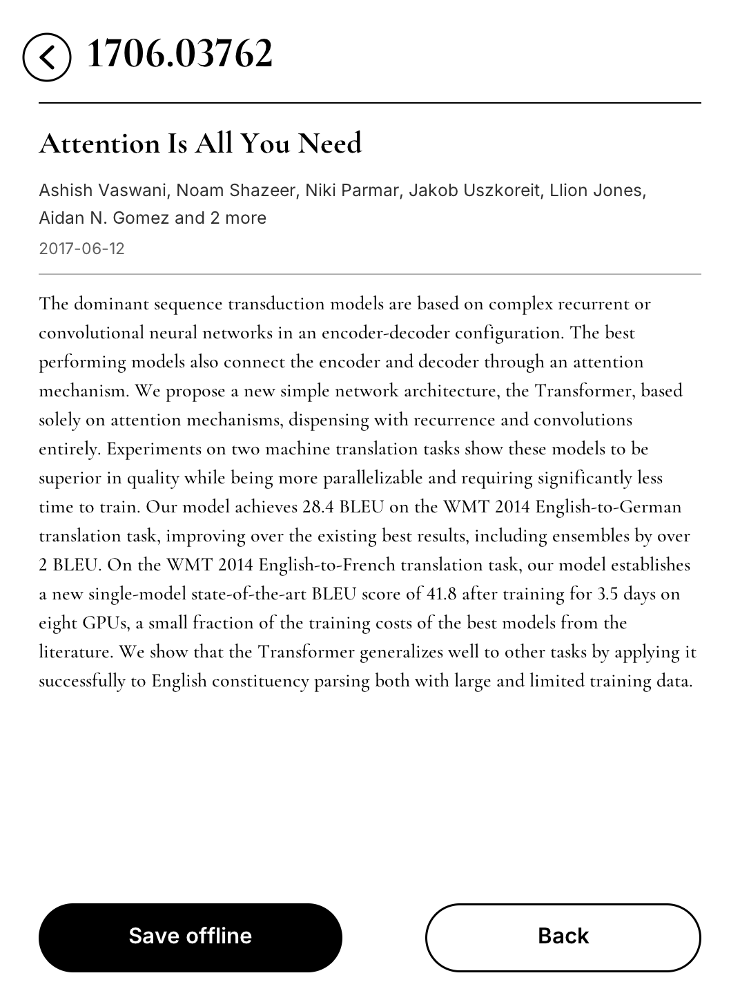 | 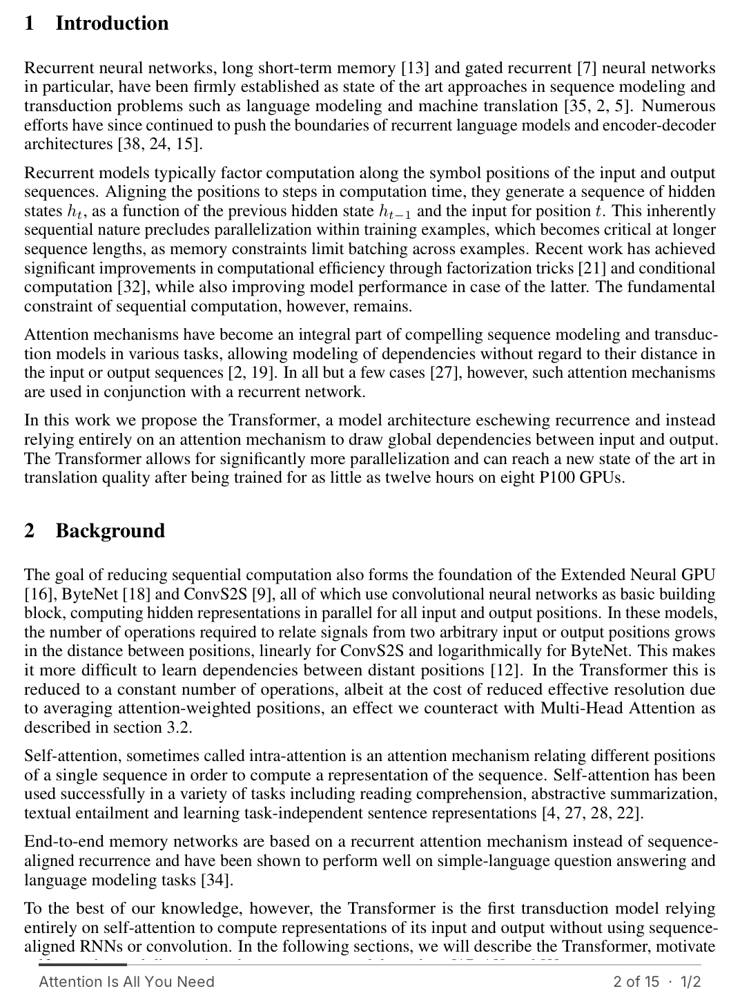 |

| Chess | Terminal | Settings |
| :---: | :---: | :---: |
| 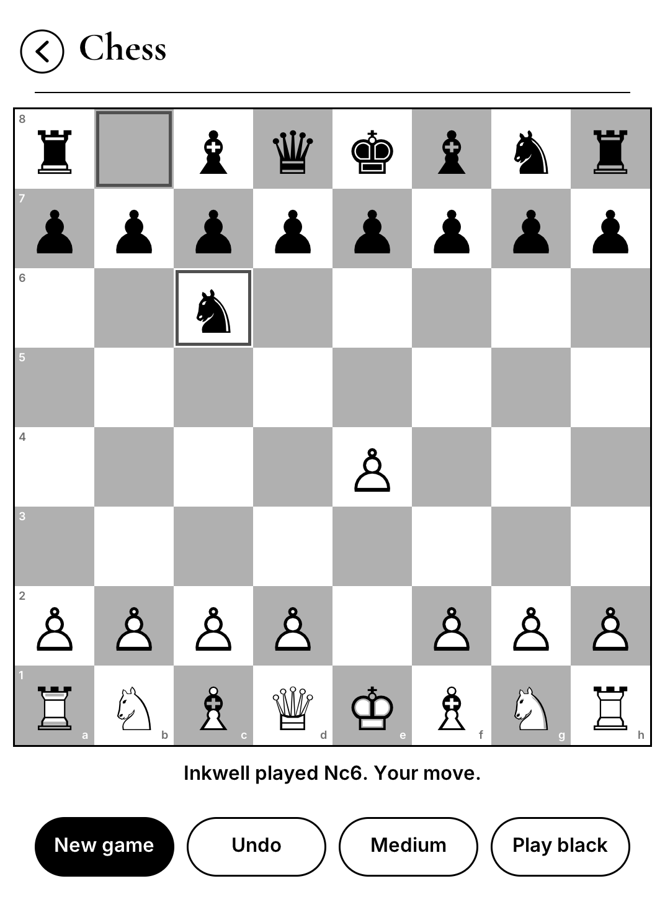 | 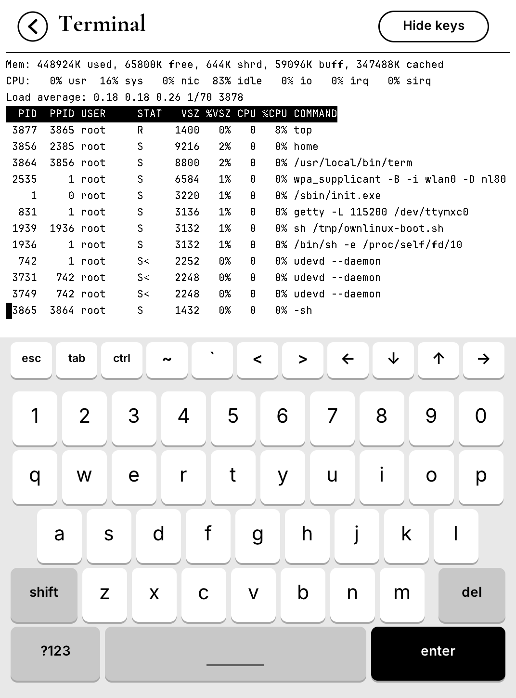 | 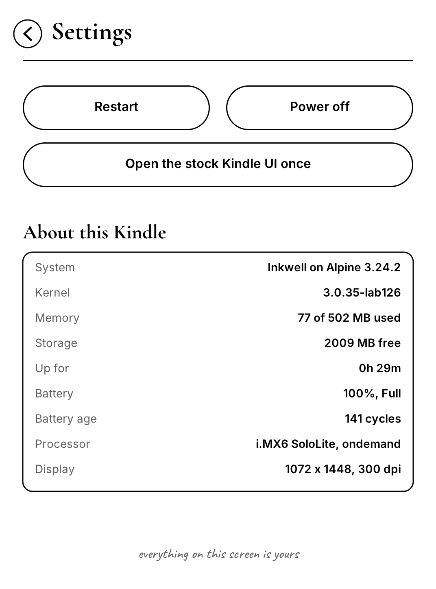 |

| Quill | TriKing | Sleep screen | Notes | Settings |
| :---: | :---: | :---: | :---: | :---: |
| 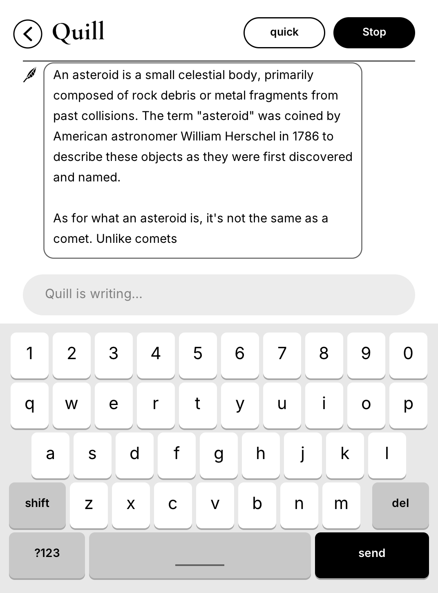 | 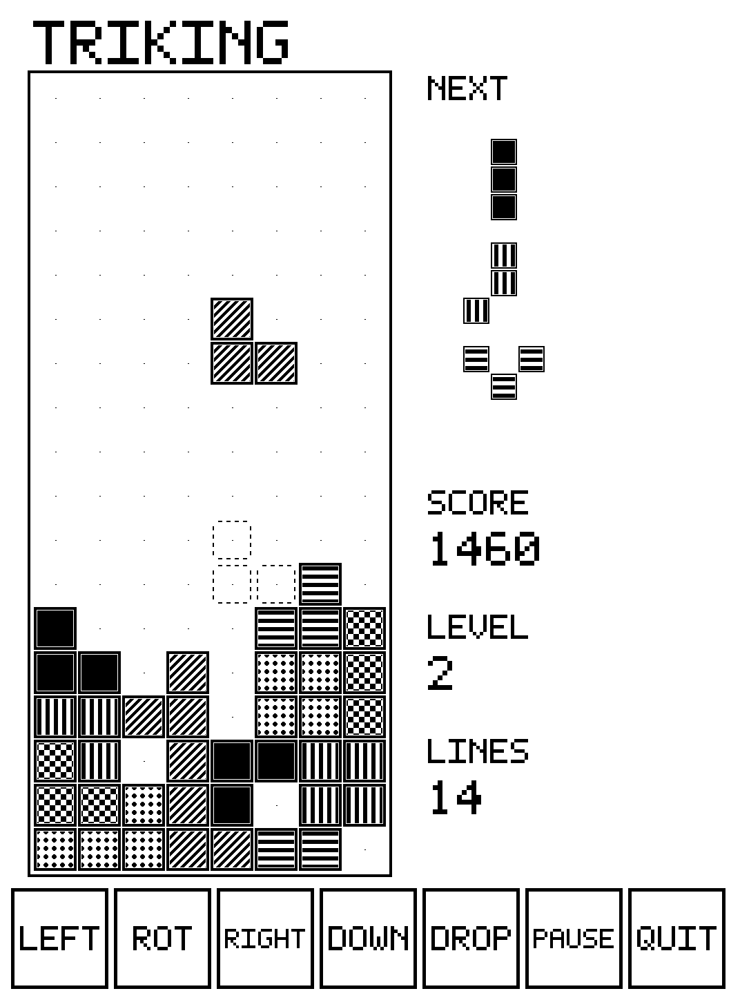 | 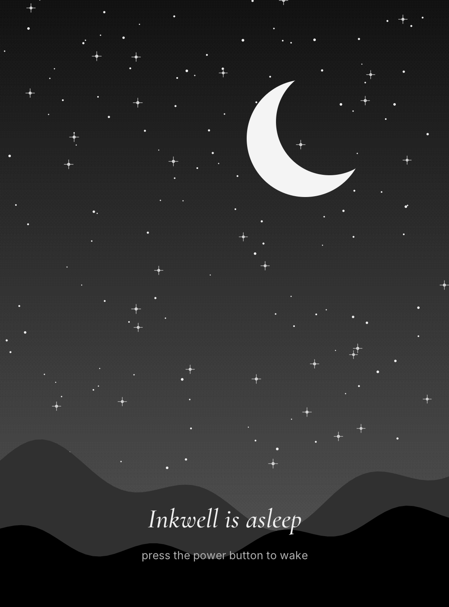 | 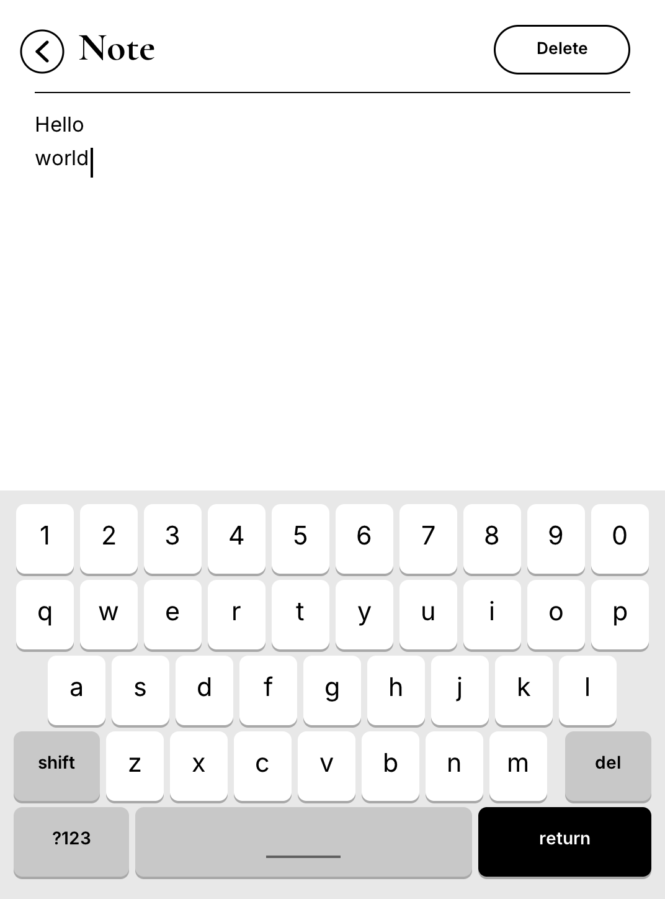 |  |

## Install

You need a **Kindle Paperwhite 3** (the 7th generation, from 2015) that is already jailbroken. [kindlemodding.org](https://kindlemodding.org) explains how to jailbreak it, for example with WinterBreak. Inkwell was built and tested on firmware 5.16.2.1.1, and it needs about 1.5 GB of free space.

1. Download `Inkwell-1.1.0.zip` from the [latest release](https://github.com/pragyaangaur/Inkwell/releases/latest) and unzip it. It contains two folders, `linux` and `documents`.
2. Connect the Kindle to your computer with a USB cable, so it shows up as a drive.
3. Copy both folders to the top of the Kindle's drive. The `documents` folder already exists there, so let your computer merge the two.
4. Eject the Kindle and unplug it.
5. Open the Kindle's library and tap **Inkwell: install**.

The Kindle reboots, shows the Inkwell splash for a moment and opens the home screen within about 20 seconds. From then on it starts Inkwell every time it boots.

## Use

Tap an app to open it, and tap the round arrow in the top left corner to go back. In Quill and the three games the power button also goes back to the home screen. On the home screen the power button puts the Kindle to sleep, and pressing it again wakes it.

**Wi-Fi.** Open Wi-Fi, tap **Scan**, tap your network and type its password. Inkwell remembers it in `linux/wifi.conf` and joins it at every boot. Wi-Fi is needed for the browser, arXiv and setting the clock.

**The smart model.** Quill comes with the quick model (135 million parameters). The release also has `smollm2-360m-q4_0.gguf`, which knows more and writes about 0.7 words per second. Put that file in the `linux/models` folder on the Kindle's drive, and the **quick** button in Quill then switches between the two. The first chat with each model takes a little longer while Quill prepares it.

**The coding model.** For coding in the terminal, put `qwen2.5-coder-0.5b-q4_0.gguf` in `linux/models` too. The release has it, and it is the Q4_0 file of [Qwen2.5 Coder 0.5B Instruct](https://huggingface.co/bartowski/Qwen2.5-Coder-0.5B-Instruct-GGUF), renamed. Without it, `quill` in the terminal uses the SmolLM2 models, which are much weaker at code. `QUILL_MODEL=quick quill` picks the fast 135M model anyway, and `smart` or `coder` pick the others. On the Kindle, the coder model wrote a correct Fibonacci program in about ten minutes, three of them spent preparing its prompt the first time.

**Books.** Copy EPUB, PDF, MOBI, FB2 or text files into the `documents` folder on the Kindle's drive, and they appear in Books. Your place, font size and bookmarks for each book are kept in `linux/reader`.

**The time zone.** Inkwell uses UTC until you tell it otherwise. Open `linux/timezone` on the Kindle's drive and replace `UTC` with your zone name, for example `Europe/London`, `America/New_York` or `Asia/Kolkata`. It takes effect at the next boot.

**SSH to your computer.** On a Mac, turn on Remote Login in System Settings, under General and then Sharing. In the Terminal app, `ssh yourname@192.168.15.201` then connects to the Mac over the USB cable. The address is the one Inkwell hands the computer, and Linux computers work the same way with their SSH server running.

**Your files.** Notes are in `notes`, sketches are in `sketches`, arXiv papers are in `arxiv`, chess games are in `chess` and Doom saves are in `doom` on the Kindle's drive. While Inkwell runs, the USB port is a network link, so to reach the drive you open the normal Kindle UI once (below) and plug in the cable.

## Going back to the normal Kindle

- **Once:** in Settings, tap **Open the stock Kindle UI once**. The Kindle reboots into its own UI, and the next boot is Inkwell again. Pressing the power button while the Inkwell splash is showing does the same thing.
- **For good:** go back to the normal UI once, then tap **Inkwell: off** in the library. **Inkwell: start** turns it back on.
- **Uninstall:** in the normal UI, tap **Inkwell: uninstall**. That removes the boot hook, and you can then delete the `linux` folder from the drive.

## If something goes wrong

Inkwell is built so that a failure leads back to the normal Kindle. The boot script marks each attempt, and Inkwell only becomes the default again after its home screen has stayed up for 20 seconds. If the boot hangs, hold the power button for about 40 seconds until the Kindle restarts, and it will come up with the normal Kindle UI. If the home screen crashes five times in a row, Inkwell also hands back to the normal Kindle.

Two logs help with problems. `linux/boot.log` on the Kindle's drive records each boot, and `/var/log/own.log` inside Inkwell records networking and the home screen.

Only the Paperwhite 3 has been tested. Other Kindles with the same i.MX6 SoloLite chip may boot it, but their touch panel, Wi-Fi chip or frontlight may differ. If you try another model, the fallback above still applies.

## SSH (optional)

Inkwell runs an SSH server on the USB link. The Kindle is `192.168.15.244`, and it hands your computer an address when you plug it in.

1. Clone this repository and run `./ssh.sh` once. It makes a key in `keys/` and prints the path of its public half.
2. In the normal Kindle UI, copy that `.pub` file to the Kindle's drive as `linux/authorized_keys`.
3. Boot Inkwell, plug in the cable and run `./ssh.sh` again to get a root shell.

Password logins are off, and the release image carries no keys, so nobody can log in until you add yours. Inside, `kindle <command>` runs a command in the Kindle's own system, `tap x y` sends a touch to the screen and `tools/shot.sh name` (on your computer) saves a screenshot to `out/name.png`. `tools/push.sh` copies files into the running system without rebuilding the image.

## How it works

The Kindle runs Linux 3.0.35 from Amazon with upstart as its init. Upstart first runs Amazon's hardware jobs (filesystems, kernel modules, the display, touch and battery), and then everything in Amazon's userspace waits for dbus: the lab126 services, X and the Java UI. Inkwell adds one upstart job, `/etc/upstart/ownlinux.conf`, that starts on `starting dbus` as a task. While a task runs, dbus stays at "starting", so none of Amazon's userspace ever starts.

```
Amazon bootloader and kernel
└─ upstart (PID 1)
   ├─ Amazon's hardware jobs: filesystems, modules, display, touch, battery
   └─ ownlinux.conf (runs before dbus, so dbus and the Kindle UI wait)
      └─ /mnt/us/linux/boot.sh
         ├─ loop-mounts alpine.img (ext3, Alpine 3.24 armv7) at /mnt/own
         ├─ switches USB from a drive to a network link, loads the Wi-Fi driver
         ├─ shows the splash (power button here gives a normal boot)
         └─ chroot /mnt/own /sbin/own-init
            ├─ home, the launcher (restarted if it crashes)
            └─ udhcpd, dropbear and wpa_supplicant in the background
```

The job only acts when `linux/BOOT_OWN` exists on the drive. `boot.sh` renames that file to `BOOT_OWN.trying` before doing anything else, and `own-init` renames it back once the home screen has stayed up. A boot that hangs therefore leaves the flag renamed, and the next boot is normal. The home screen's exit code says what happens next: 10 asks for the normal UI once, 11 reboots and 12 powers off. Leaving Inkwell always goes through a reboot, because the alternative of handing back to Amazon's boot in place once left the image mounted while the computer also had the drive mounted, which corrupted it.

Inkwell's own software is in C. `src/ui/eink.h` drives the framebuffer and the e-ink controller, draws text with stb_truetype and a glyph cache, and reads the multitouch panel and power button into an event queue. `src/ui/gfx.h` draws anti-aliased shapes and dithers, and `src/ui/ui.h` has the buttons, the header, toasts and the on-screen keyboard. Every binary is static, built for armv7 with Apple's clang against Alpine's musl, so the image needs no toolchain. The type is Inter, Cormorant Garamond, Caveat and JetBrains Mono.

Quill's model runs in `inkllm`, a small program around llama.cpp that Quill talks to through a pipe. The system prompt is evaluated once per model and cached to the drive, so a new chat starts at once. The context is 1024 tokens, and answers stop at 240 tokens.

## Things learned on the way

- **The e-ink refresh ioctl.** `MXCFB_SEND_UPDATE` on this kernel takes a 72-byte struct (`0x4048462E`). The 76-byte form from newer kernel headers returns `EINVAL`, and the screen then never updates.
- **Refresh speeds.** Measured on the device, a refresh takes the same time whatever the region size. Inkwell uses A2 for anything interactive and partial GC16 for page changes, with a full flash every eighth page to clear ghosting.

  | Waveform | Time | Use |
  | --- | --- | --- |
  | A2 | 190 ms | black and white only: typing, Doom, Minecraft |
  | DU | 380 ms | TriKing |
  | GC16, GL16 | 660 ms | page changes with grey |

- **A2 and grey.** The panel keeps the top four bits of each pixel, so it stores 16 levels. A2 only moves pixels between black and white and leaves a pixel that starts at a grey level alone. Quill's message box was `0xEC`, which is level 14, so typed letters stayed invisible until typing paused and a slower refresh ran. `0xF0` is level 15, which A2 treats as white, and the terminal draws its text without anti-aliasing for the same reason.
- **Half floats on the Cortex-A9.** Clang defines `__ARM_FP16_FORMAT_IEEE` on every 32-bit Arm target, so ggml converted each block's fp16 scale through a software routine. The A9 has no half-precision hardware. `build-llm.sh` patches ggml to require real fp16 support (`__ARM_FP & 2`), and that doubled the speed. Afterwards the 135M model makes 1.7 tokens per second and reads prompts at 4.4 tokens per second, and the 360M model makes 0.72 tokens per second. The KV cache is f32 for the same reason.
- **Touch input.** The kernel drops a coordinate that has not changed, so a finger landing exactly where the last one lifted sends no position. Inkwell counts a new tracking id as movement. Taps also arrive in bursts while the panel refreshes, so input is queued, since keeping only the first tap lost keystrokes.
- **Boot time.** The home screen appears about 15.9 seconds after the kernel starts. About 14 seconds of that is Amazon's hardware jobs, and loading the display waveforms alone takes about 3 seconds. Inkwell loads its drivers while the splash is showing and starts networking after the home screen, and it switches the CPU to the `ondemand` governor, since Amazon keeps it at full speed until its own home screen loads. Inkwell uses about 40 MB of the 512 MB of memory.
- **Touches across apps.** The kernel only reports a coordinate when it changes. While one app runs another, the first one's input stream fills with the second one's touches, and throwing those away on return left it with a stale position. A tap on the same spot as the last tap in the other app then went to the wrong place. Each app now follows the finger through those touches without acting on them, and writes the last position to `/run/own/touch` for the next app that starts.
- **MuPDF on a pipe.** Books keeps one `mutool run` process open and talks to it line by line. On a pipe the C library held its answers in a buffer until it quit, so its output goes through a pseudo-terminal, which is flushed at every line.
- **Where not to mount.** Amazon's boot jobs give everything under `/var/tmp` to `javauser` with group-writable modes, which breaks SSH's key checks and exec bits. The image is mounted at `/mnt/own` instead.

## Build it yourself

The build runs on macOS (Apple Silicon or Intel). Linux should work with small changes, but it has not been tried.

```bash
brew install llvm lld cmake ninja e2fsprogs
```

```bash
git clone https://github.com/pragyaangaur/Inkwell.git && cd Inkwell
```

```bash
tools/fetch.sh
```

```bash
./build-rootfs.sh
```

`tools/fetch.sh` downloads the Alpine minirootfs and packages, a sysroot made from Alpine's musl and libc++ packages, llama.cpp v0.7.0, the shareware Doom WAD and the three models into `downloads/`. `./build-rootfs.sh` compiles everything and writes `out/alpine.img`, and `tools/release.sh 1.1.0` builds the release zip in `dist/`. Set `TZ_NAME` to change the image's default time zone. If `keys/` holds a key from `./ssh.sh`, the image you build includes it.

| Path | What it holds |
| --- | --- |
| `src/ui/` | The home screen, the apps and the shared e-ink, drawing and UI headers |
| `src/chat/` | Quill and `inkllm`, the llama.cpp runner |
| `src/doom/` | doomgeneric and `doomgeneric_kindle.c`, the Kindle port |
| `src/minecraft.c`, `src/triking.c`, `src/kio.h` | The two games, freestanding with raw syscalls |
| `src/rd/` | rdgeneric, the Minecraft rd-132211 core |
| `src/linux/` | The upstart job, `boot.sh` and the boot splash |
| `src/rootfs/` | Files laid over Alpine: `own-init`, the app list, Quill's system prompt |
| `kindle/documents/` | The library scriptlets that install, start, stop and uninstall |
| `tools/` | Cross compilers, fetch and release scripts, SSH helpers |
| `fonts/`, `third_party/` | The typefaces with their licences, and stb_truetype |

## Credits

Inkwell stands on a lot of other people's work: [Alpine Linux](https://alpinelinux.org), [llama.cpp](https://github.com/ggml-org/llama.cpp), [SmolLM2](https://huggingface.co/HuggingFaceTB/SmolLM2-135M-Instruct) from Hugging Face (Q4_0 files by [bartowski](https://huggingface.co/bartowski)), [doomgeneric](https://github.com/ozkl/doomgeneric), id Software's Doom and its shareware episode, [stb_truetype](https://github.com/nothings/stb), the Inter, Cormorant Garamond, Caveat and JetBrains Mono typefaces, the chess symbols from DejaVu Sans, and the Kindle jailbreak community at [kindlemodding.org](https://kindlemodding.org). The jailbreak itself comes from that community, and Inkwell only starts where it ends.

## Licence

Inkwell's own code is under the MIT licence in `LICENSE`. The Doom port in `src/doom/` is under the GNU GPL version 2, like the Doom source it comes from. The fonts are under the SIL Open Font License, except the DejaVu chess symbols, which are under the Bitstream Vera licence. Each licence is in `fonts/`. The release image also contains Alpine's packages under their own licences.
